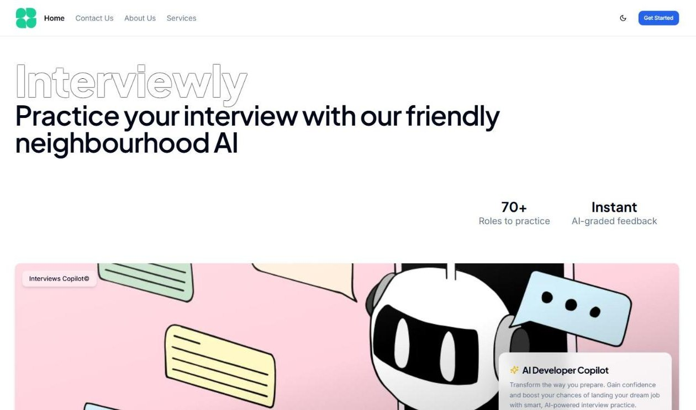
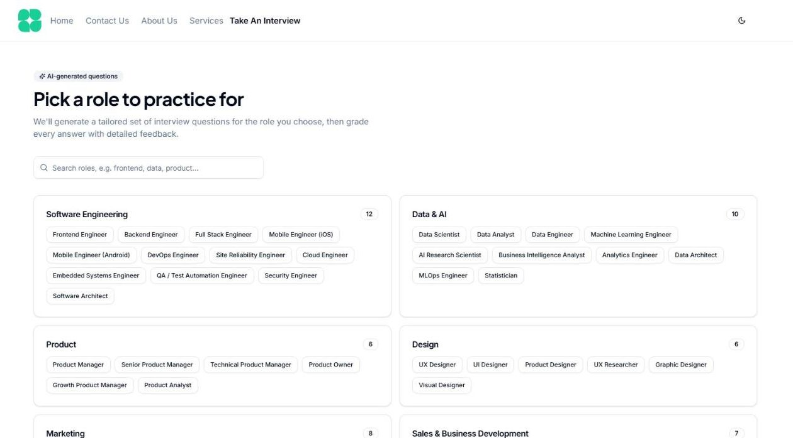
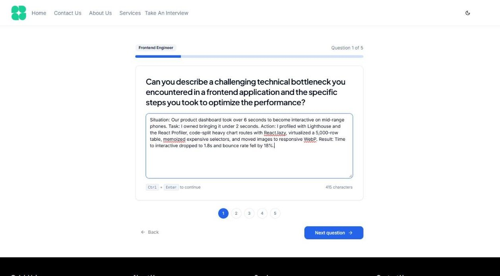
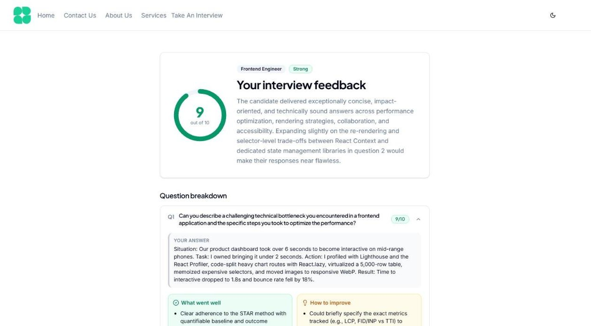
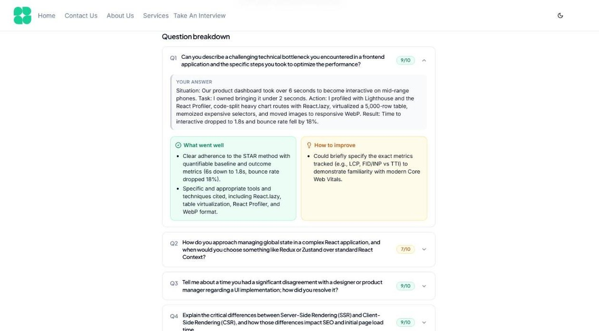
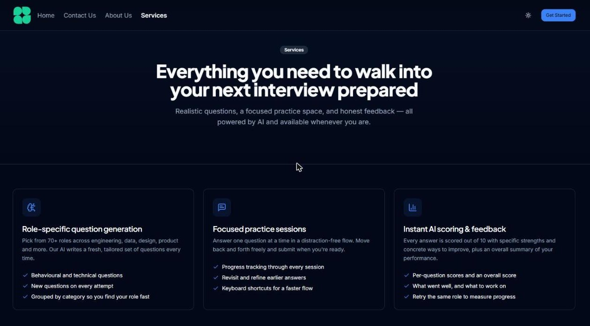

# Interviewly — AI Mock Interviews

Practice job interviews with AI-generated questions and get instant, detailed feedback on every answer.

**🔗 Live site: https://main.d2tjv0xxmmfjwy.amplifyapp.com**



---

## Using the live site

1. **Open the site** at the link above and click **Get Started**.
2. **Create an account** (or sign in) — sign-in is handled securely by Clerk.
3. **Pick a role.** Go to **Take An Interview** and choose from 70+ roles across engineering, data, design, product and more. Use the search box to find yours quickly.
4. **Answer the questions.** The AI generates a fresh set of questions for that role (this takes a few seconds).
   - Type your answer in the box, then click **Next question** — or press **Ctrl + Enter**.
   - Use **Back** or the numbered dots to revisit and edit earlier answers.
   - A tip: structure answers as *Situation → Task → Action → Result*.
5. **Submit for feedback.** On the last question, click **Submit for feedback**. The AI grades all your answers in one go.
6. **Review your results.** You'll see:
   - an **overall score** out of 10 with a summary,
   - a **score for each question**, plus **what went well** and **how to improve**.
7. **Practice again.** Choose **Try this role again** for a brand-new set of questions, or **Practice another role**.

Other pages: **Services** (features + FAQ), **About Us**, and **Contact Us**. Use the ☀️/🌙 button in the header to switch between light and dark mode.

> **Note:** Authentication currently runs on a Clerk *development* instance, so you may see a small "Development mode" badge on the sign-in screen. It works normally but is intended for testing and demo use.

---

## Screenshots

<table>
  <tr>
    <td width="50%"><br><sub><b>1. Pick a role</b> — search or browse 70+ roles by category</sub></td>
    <td width="50%"><br><sub><b>2. Answer questions</b> — progress bar, jump-to-question dots, Ctrl+Enter</sub></td>
  </tr>
  <tr>
    <td width="50%"><br><sub><b>3. Get your score</b> — overall score out of 10 with an AI summary</sub></td>
    <td width="50%"><br><sub><b>4. Review each answer</b> — strengths and how to improve, per question</sub></td>
  </tr>
  <tr>
    <td colspan="2"><br><sub><b>Dark mode</b> — toggle with the ☀️/🌙 button in the header</sub></td>
  </tr>
</table>

---

## Features

- 🎯 **Role-specific questions** generated by Google Gemini for 70+ roles
- ✍️ **Focused practice flow** with progress tracking, back/forward navigation and keyboard shortcuts
- 📊 **AI scoring & feedback** — per-question scores, strengths, and improvement tips
- 🌗 **Light / dark mode** that follows your system setting by default
- 📱 **Responsive** layout for desktop and mobile

## Tech stack

| Layer | Technology |
|---|---|
| Frontend | React 19, TypeScript, Vite, Tailwind CSS, shadcn/ui, React Router |
| Auth | Clerk |
| Backend API | Django REST Framework on AWS Lambda (via Mangum), exposed with a Lambda Function URL |
| Database | Amazon DynamoDB |
| AI | Google Gemini |
| Hosting | AWS Amplify Hosting (frontend), AWS SAM / CloudFormation (backend), Region `us-east-2` |

```
Browser ──► Amplify Hosting (React app)
   │
   └──► Lambda Function URL ──► Django API ──► DynamoDB
                                    └────────► Gemini
```

---

## Running locally

**Prerequisites:** Node.js 20+, [pnpm](https://pnpm.io/), and (for the backend) Python 3.12.

### Frontend

```bash
pnpm install
pnpm dev
```

Then open http://localhost:5173.

Create a `.env.local` in the project root:

```bash
VITE_CLERK_PUBLISHABLE_KEY=pk_test_...
VITE_API_BASE_URL=https://<your-function-url>.lambda-url.us-east-2.on.aws
VITE_CONTACT_EMAIL=you@example.com   # optional — enables the Contact form

VITE_FIREBASE_API_KEY=...
VITE_FIREBASE_AUTH_DOMAIN=...
VITE_FIREBASE_PROJECT_ID=...
VITE_FIREBASE_STORAGE_BUCKET=...
VITE_FIREBASE_MESSAGING_SENDER_ID=...
VITE_FIREBASE_APP_ID=...
```

> `VITE_*` values are compiled into the public JavaScript bundle — only put publishable/public keys here, never secrets.

### Backend

See [`backend/README.md`](backend/README.md) for running the API locally, running tests, and the backend environment variables.

---

## Deployment

### Frontend (AWS Amplify Hosting)

The frontend is deployed **manually** (it is not yet connected to GitHub, so pushing to `main` does **not** update the live site). To redeploy:

```bash
pnpm build
# zip the *contents* of dist/ (use a tool that writes forward-slash paths;
# PowerShell 5.1's Compress-Archive does not)
python -c "import shutil; shutil.make_archive('dist', 'zip', 'dist')"

aws amplify create-deployment --app-id d2tjv0xxmmfjwy --branch-name main \
  --profile interviewly --region us-east-2
# → upload dist.zip to the returned zipUploadUrl:
curl -X PUT -H "Content-Type: application/zip" --data-binary @dist.zip "<zipUploadUrl>"
# → then start it with the returned jobId:
aws amplify start-deployment --app-id d2tjv0xxmmfjwy --branch-name main --job-id <jobId> \
  --profile interviewly --region us-east-2
```

The Amplify app has a rewrite rule that serves `index.html` for client-side routes, so deep links like `/services` work on refresh.

### Backend (AWS SAM)

See [`backend/README.md`](backend/README.md#deploy-to-aws-free-tier). When deploying, pass **both** origins (comma-separated) so local development and the live site keep working:

```
AllowedOrigin=http://localhost:5173,https://main.d2tjv0xxmmfjwy.amplifyapp.com
AllowedAzp=http://localhost:5173,https://main.d2tjv0xxmmfjwy.amplifyapp.com
```

---

## Project structure

```
├── src/
│   ├── routes/        # Pages: home, generate, interview, feedback, about, services, contact
│   ├── components/    # Header, footer, theme toggle, shadcn/ui components
│   ├── layouts/       # Public and protected (signed-in) layouts
│   ├── hooks/         # useApi — authenticated API calls
│   └── lib/           # API client, helpers, score colours
├── public/            # Static images and logos
├── docs/screenshots/  # Images used in this README
└── backend/           # Django API, SAM template, tests
```
